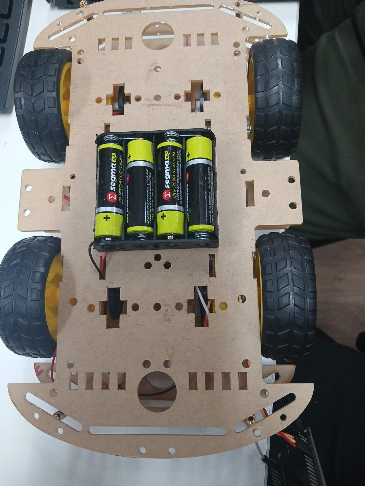
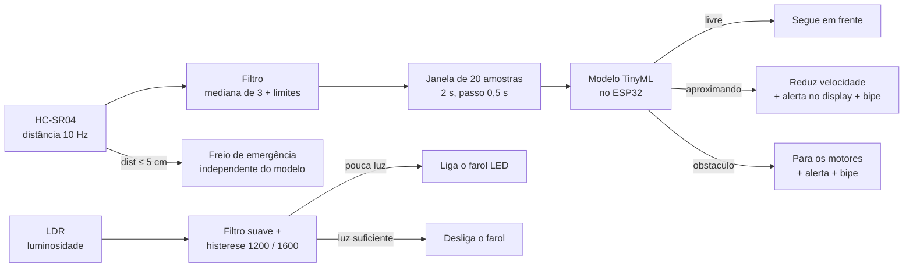
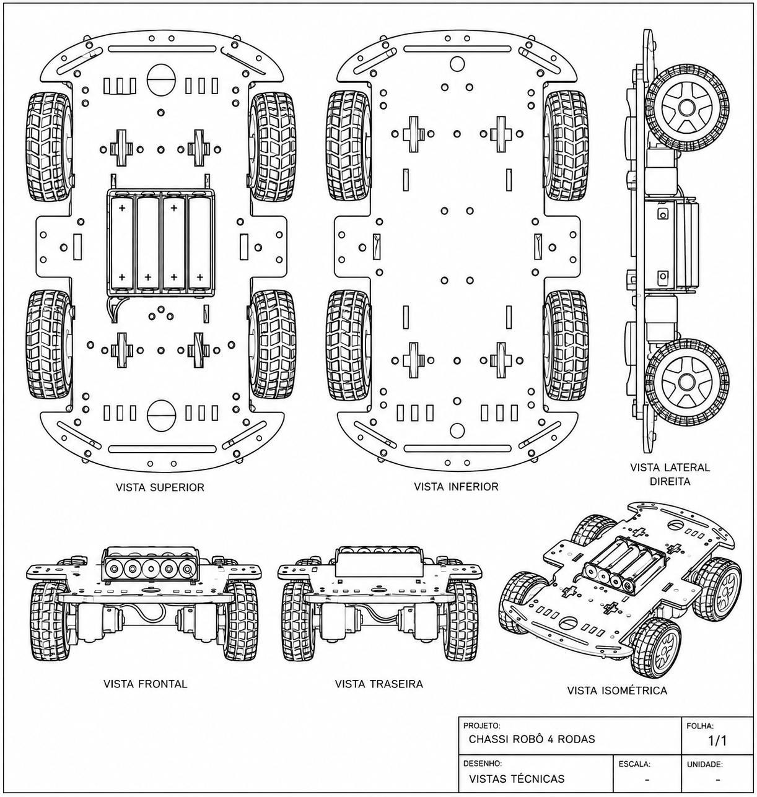

# RotaLivre — robô-sentinela de calçadas acessíveis e bem iluminadas

**Project-Based Maker Lab · Global Solution 2026.2 · CitizenTech · Engenharia de Software 4º ano (FIAP)**

Evolução do carrinho-robô 4WD (CP1 → CP2 → GS): o ESP32 lê um **sensor ultrassônico** (obstáculos e aproximações, classificados por um modelo **TinyML** embarcado) e um **sensor de luminosidade LDR** (iluminação insuficiente → acende o farol automaticamente), tudo no próprio dispositivo, sem câmera, sem microfone e sem coletar dados pessoais.

## 👥 Integrantes

| Nome completo | RM |
| ------------- | -- |
| Bruno Eduardo Caputo Paulino | 558303 |
| Lucas Rodrigues | 98344 |
| **[PREENCHER: nome completo]** | 552202 |
| **[PREENCHER: nome completo]** | 98118 |

## 🎥 Vídeo de demonstração (até 6 min)

**[PREENCHER: link do vídeo (YouTube não listado ou link público que abra em janela anônima)]**

---

## 🧾 Ficha Técnica do MVP

| Campo | Resposta |
| ----- | -------- |
| **Nome do produto** | RotaLivre |
| **Cidadão e território** | Pessoas com deficiência visual ou de mobilidade e idosos que dependem de calçadas e passagens livres e iluminadas; agentes de zeladoria urbana como segundo público. Território: calçadas, corredores e pontos de espera em áreas urbanas. |
| **Problema, em uma frase** | Calçadas e passagens obstruídas ou mal iluminadas tiram a autonomia e a segurança de quem tem mobilidade reduzida ou baixa visão, e hoje isso só é descoberto quando alguém reclama. |
| **Proposta de valor** | Um dispositivo de baixo custo que percebe obstrução e falta de luz no próprio local, reage na hora (para, desacelera, alerta e ilumina) e sustenta uma inspeção contínua do espaço público sem câmeras e sem dados pessoais. |
| **Arquitetura: componentes** | ESP32 WROOM-32 · chassi 4WD + ponte H L298N · HC-SR04 (distância) · LDR + LED (luminosidade/farol) · display OLED SSD1306 · buzzer · controle BLE (Dabble) · modelo TinyML (Edge Impulse). Detalhes na seção 4. |
| **Fontes de dados** | Dados próprios coletados pelo sensor: 15 séries de distância (605 amostras, 10 Hz) em `dataset/` e leituras do LDR (0–4095) em tempo real. Metodologia e limitações em `dataset/LEIAME_dataset.txt`. |
| **Modelos de IA utilizados** | Rede neural densa (Edge Impulse, *raw data*, janela de 2 s, 3 classes: `livre`, `aproximando`, `obstaculo`), quantizada em int8 e executada no ESP32. |
| **URL do MVP e repositório** | Repositório: **[PREENCHER: URL deste repositório]** · MVP da equipe (outras disciplinas): **[PREENCHER: URL do MVP]** |
| **Indicadores de impacto** | Ver seção 8. |
| **ODS conectados** | 11, 10 e 9 (seção 7). |

---

## 1. Problema, evidência e cidadão

- O Censo 2022 do IBGE contou **14,4 milhões de pessoas com deficiência no Brasil (7,3% da população com 2 anos ou mais)**; a dificuldade funcional mais frequente foi enxergar, mesmo com óculos ou lentes (cerca de **7,9 milhões**), e idosos de 60 anos ou mais são **45,4%** das pessoas com deficiência. Fonte: IBGE, *Censo Demográfico 2022: Pessoas com Deficiência e Pessoas Diagnosticadas com TEA — resultados preliminares da amostra* (divulgado em 23/05/2025, Agência de Notícias do IBGE).
- A norma **ABNT NBR 9050** define que a *faixa livre* da calçada, destinada exclusivamente ao pedestre, deve ser **livre de qualquer obstáculo, com no mínimo 1,20 m de largura e 2,10 m de altura livre**.
- Na prática, lixeiras, entulho, veículos e mobiliário invadem essa faixa e a iluminação falha em pontos de espera e passagens. Quem depende da rota (bengala, cadeira de rodas, baixa visão) é quem mais sofre, e a manutenção só fica sabendo depois.

**Escala do protótipo:** o carrinho simula esse cenário em bancada: obstáculo parado a 7–19 cm representa a faixa obstruída, e a mão ou objeto que se aproxima representa uma pessoa ou objeto entrando na rota.

## 2. Como a solução funciona

O cidadão não interage com nada: o dispositivo funciona sozinho no local e reage ao ambiente. O controle Dabble existe para operação e demonstração (modo manual, piloto automático e modo TinyML).

## 3. Sensor adicional e inteligência

### 3.1 Sensor adicional: LDR (iluminação)

| Item | Valor (conforme `src/gedeane/gedeane.ino`) |
| ---- | ----------------------------------------- |
| Sensor / pino | LDR no GPIO 34 (ADC 12 bits, 0 = escuro, 4095 = muito claro) |
| Atuador | LED do farol no GPIO 27 |
| Leitura | a cada 100 ms, com média móvel exponencial (80 % anterior + 20 % nova) |
| Liga o farol | leitura suavizada **< 1200** |
| Desliga o farol | leitura suavizada **> 1600** |
| Histerese | faixa 1200–1600 evita o farol piscar em luz intermediária |
| Depuração | `LDR_DEBUG` imprime o valor no Serial a cada 500 ms para calibrar |

O farol funciona em **todos os modos** (manual, piloto automático e TinyML). A decisão do farol é por **regra com histerese** (sensor → decisão local), não por modelo de IA. Veja as limitações na seção 9.

### 3.2 IA embarcada (TinyML) com o ultrassônico

- **Sensor:** HC-SR04 frontal, 10 Hz, 1 eixo (`dist_cm`).
- **Pré-processamento (igual no treino e no firmware):** sem eco ou ≥ 200 cm → 200 cm; leitura < 2 cm → repete a última válida; mediana das 3 últimas leituras (`lerDistanciaTratada()`).
- **Janela:** 2000 ms (20 amostras), passo de 500 ms.
- **Classes:** `obstaculo` (leituras ≤ 22 cm, desvio ≤ 3 cm), `livre` (leituras ≥ 40 cm) e `aproximando` (queda ≥ 15 cm na janela, começando em ≥ 25 cm).
- **Modelo:** Edge Impulse, projeto `Brunin-project-1`, bloco *Raw data* + rede densa, exportado como biblioteca Arduino, **quantizado em int8**, EON Compiler (arena de ~3 KB; estimativa de ~1,4 KB de RAM e ~13–15 KB de flash).
- **Decisão:** a classe vencedora com confiança ≥ 0,60 define a ação. Abaixo disso, mantém a ação anterior.

| Classe | Ação no carrinho |
| ------ | ---------------- |
| `livre` | segue em frente |
| `aproximando` | reduz a velocidade, alerta no display e bipe curto |
| `obstaculo` | para os motores, alerta no display e bipe |

- **Freio de emergência** (`TINYML_FREIO_EMERGENCIA`): para se a distância for ≤ 5 cm, mesmo se o modelo errar, por causa do atraso da janela de 2 s.
- Se o loop ficar bloqueado (dança, sirene, melodia), a janela é descartada e reenchida, para não classificar dados velhos.
- No Monitor Serial aparecem as probabilidades das 3 classes e a ação tomada a cada inferência.

**IA responsável e LGPD:** o dispositivo só processa **distância e luminosidade**. Não há câmera, áudio, identificação de pessoas nem envio de dados; a inferência roda 100 % no ESP32. O freio de emergência mantém uma regra determinística de segurança acima do modelo.

## 4. Integração hardware ↔ software

| Componente | Função | Pino (ESP32) |
| ---------- | ------ | ------------ |
| Ponte H L298N | motores (controle diferencial, lados pareados) | IN1=13, IN2=4, IN3=33, IN4=32, ENA=19 (PWM), ENB=18 (PWM) |
| HC-SR04 | distância frontal | TRIG=25, ECHO=26 |
| LDR | luminosidade | 34 (ADC) |
| LED do farol | iluminação | 27 |
| Buzzer | alertas sonoros | 5 |
| OLED SSD1306 128×64 | rostos/estados do robô | I²C padrão do ESP32 (SDA 21, SCL 22), endereço 0x3C |
| Controle | app Dabble (BLE), módulo GamePad, nome BLE `Carrinho Bluetooth Grupo Pedrao` | — |

**Importante:** o GND do ESP32 e o da ponte H precisam estar em comum.

### Controles (Dabble GamePad)

| Botão | Ação |
| ----- | ---- |
| Setas | movimento manual |
| Triângulo | liga/desliga o piloto automático (desvio por limiar fixo de 15 cm, perigo a 5 cm) |
| **SELECT** | liga/desliga o **modo TinyML** |
| Quadrado / Círculo / X / START | buzina / melodia / dança / sirene |

Fotos de bancada: [`teste_motor_app.jpg`](Hardware/teste_motor_app.jpg) e [`teste_bancada_ponte_h.jpg`](Hardware/teste_bancada_ponte_h.jpg). Peças modeladas (STL) em [`CAD/`](CAD/) e cronograma de montagem em [`docs/cronograma_carrinho.pdf`](docs/cronograma_carrinho.pdf).

## 5. Como reproduzir

1. **Arduino IDE** com o pacote de placas **ESP32 (core 3.x**, o firmware usa `ledcAttach`) e a placa *ESP32 Dev Module*.
2. **Bibliotecas** (Gerenciador de Bibliotecas): `DabbleESP32`, `Adafruit GFX Library`, `Adafruit SSD1306`.
3. **Biblioteca do modelo:** *Sketch → Incluir Biblioteca → Adicionar biblioteca .ZIP* e selecione [`model/ei-brunin-project-1-arduino-1.0.1-impulse-1.zip`](model/ei-brunin-project-1-arduino-1.0.1-impulse-1.zip) (gera `Brunin-project-1_inferencing`).
4. Abra [`src/gedeane/gedeane.ino`](src/gedeane/gedeane.ino), selecione a porta e faça o upload (115200 baud no Monitor Serial).
5. No celular, abra o **Dabble**, conecte em `Carrinho Bluetooth Grupo Pedrao` e abra o módulo **GamePad**.
6. Pressione **SELECT** para ligar o modo TinyML. O Monitor Serial mostra as probabilidades e `ACAO`. Cubra o LDR com a mão para ver o farol ligar.

**Para retreinar:** importe os CSVs de [`dataset/csv/`](dataset/csv/) no Edge Impulse (*Infer label from filename*), com o impulse *Time series* (2000 ms / passo 500 ms / 10 Hz / 1 eixo). Evidências em [`edge-impulse/prints/`](edge-impulse/prints/).

## 6. Dataset, treino e resultados

| Classe | Arquivos | Amostras | Duração | Janelas (2 s / passo 0,5 s) |
| ------ | -------: | -------: | ------: | --------------------------: |
| aproximando | 5 | 105 | 10,5 s | 6 |
| livre | 5 | 180 | 18,0 s | 21 |
| obstaculo | 5 | 320 | 32,0 s | 49 |
| **Total** | **15** | **605** | **60,5 s** | **76** |

Os dados foram coletados com o ESP32 imprimindo `timestamp,dist_cm` no Serial e rotulados por regras de distância/tendência (ver `dataset/LEIAME_dataset.txt`).

Três iterações no Edge Impulse (prints `01` a `10`):

| Iteração | Bloco | Resultado (validação) | Diagnóstico |
| -------- | ----- | --------------------- | ----------- |
| 1 | Flatten (7 estatísticas), padrão | acurácia 53,3 %, loss 1,00 | *underfitting*: features sem escala e *learning rate* baixo |
| 2 | Flatten, com ajustes | acurácia 93,3 %, loss 2,74, **`aproximando` 0 %** | o Flatten descarta a ordem temporal e `aproximando` é definida por tendência; a acurácia alta escondia a classe perdida |
| 3 | **Raw data** (20 valores em ordem) + rede densa | acurácia 93,3 %, loss 0,13, AUC 0,97 | modelo bem calibrado; `aproximando` ainda cai em `livre` na validação |

**Teste final (conjunto de teste, 3 arquivos):** acurácia 75,00 %; F1 por classe: `livre` 1,00, `obstaculo` 0,80, `aproximando` 0,00. Na matriz de confusão, `livre` e `obstaculo` foram 100 % corretos, e `aproximando` foi classificada como `obstaculo`.

> O conjunto de teste tem cerca de 1 janela por classe, então as métricas **não têm peso estatístico**. O resultado confiável é qualitativo: o modelo separa `livre` de `obstaculo` e **não aprendeu `aproximando`**. O erro cai do lado seguro (o carrinho trata como obstáculo e para), e o erro perigoso (`obstaculo` visto como `livre`) não ocorreu no teste.

### Cenários demonstrados no vídeo

| Cenário | Entrada | Comportamento esperado |
| ------- | ------- | ---------------------- |
| Passagem livre | nada a frente (≥ 40 cm ou sem eco) | `livre`: segue em frente |
| Faixa obstruída | obstáculo parado a ≤ 22 cm | `obstaculo`: para, alerta e bipe |
| Algo entra na rota | objeto se aproximando | tende a `obstaculo` (limitação conhecida) |
| Quase colisão | distância ≤ 5 cm | freio de emergência, independente do modelo |
| Pouca luz | LDR suavizado < 1200 | farol liga |
| Luz volta | LDR suavizado > 1600 | farol desliga |

## 7. ODS conectados

| ODS | Como o RotaLivre contribui |
| --- | -------------------------- |
| **11. Cidades e comunidades sustentáveis** | Meta 11.7 (espaços públicos seguros, inclusivos e acessíveis, em especial para idosos e pessoas com deficiência) e meta 11.2 (acessibilidade nos deslocamentos): detecta obstrução da rota e iluminação insuficiente, que são barreiras diretas à circulação. |
| **10. Redução das desigualdades** | Meta 10.2 (inclusão de todos, independentemente de deficiência): o foco é quem hoje tem sua autonomia limitada pelo estado do espaço público. |
| **9. Indústria, inovação e infraestrutura** | Meta 9.1 (infraestrutura de qualidade, com acesso equitativo e preço acessível): inteligência embarcada em hardware de baixo custo (ESP32), que funciona sem internet. |

## 8. Indicadores de impacto (propostos)

| Indicador | Como medir com o dispositivo |
| --------- | ---------------------------- |
| Obstruções detectadas por trecho/dia | contagem de eventos `obstaculo` por posição e período |
| Tempo de reação | janela de 2 s + passo de 0,5 s (latência máxima de decisão do modelo) e freio de emergência imediato a ≤ 5 cm |
| % do tempo com iluminação insuficiente | proporção do tempo com LDR suavizado abaixo do limiar de 1200 |
| Cobertura | número de trechos/pontos monitorados por dispositivo, a um custo de hardware baixo |

Hoje os eventos aparecem no Monitor Serial; o envio ao MVP da equipe está no roadmap (seção 9).

## 9. Limitações e próximos passos

- `aproximando` **não foi aprendida**: 6 janelas de treino e rótulos por regra. Próximo passo: gravar mais exemplos com rotulagem manual, em outras distâncias e ângulos, e retreinar.
- O dataset é pequeno e o conjunto de teste não tem peso estatístico.
- O **LDR ainda não alimenta o modelo**: o farol decide por limiar com histerese. Próximo passo: fundir luminosidade e distância no mesmo impulse (ex.: obstáculo + escuro como situação de maior risco).
- O sketch usado para gravar o dataset não está versionado neste repositório.
- Os eventos ainda não são enviados a uma plataforma. Próximo passo: telemetria (Wi-Fi/MQTT/HTTP) para o MVP da equipe e um mapa de pontos críticos para a zeladoria.
- Protótipo em bancada, em escala reduzida; a validação em calçadas reais é um próximo passo.

## 10. Evolução do projeto

| | CP1 | CP2 | GS (CitizenTech) |
| - | --- | --- | ---------------- |
| Sensores | HC-SR04 | HC-SR04 | HC-SR04 + **LDR** |
| Decisão | `if distância < limite` | classificação TinyML em 3 classes | TinyML + farol automático por luminosidade, enquadrados no problema de acessibilidade |
| Foco | montar e controlar o carrinho | IA embarcada | problema real do cidadão e impacto (ODS) |

## 📁 Estrutura do repositório

| Pasta | Conteúdo |
| ----- | -------- |
| `src/gedeane/` | Firmware do ESP32 (`gedeane.ino`): controle, piloto automático, farol (LDR) e inferência TinyML |
| `model/` | Biblioteca Arduino exportada do Edge Impulse |
| `dataset/` | 15 CSVs (`csv/`) e `LEIAME_dataset.txt` com a metodologia |
| `edge-impulse/prints/` | Evidências do processo no Edge Impulse |
| `CAD/` | Peças modeladas (STL) |
| `Hardware/` | Croqui do chassi e fotos |
| `docs/` | Cronograma de montagem |
